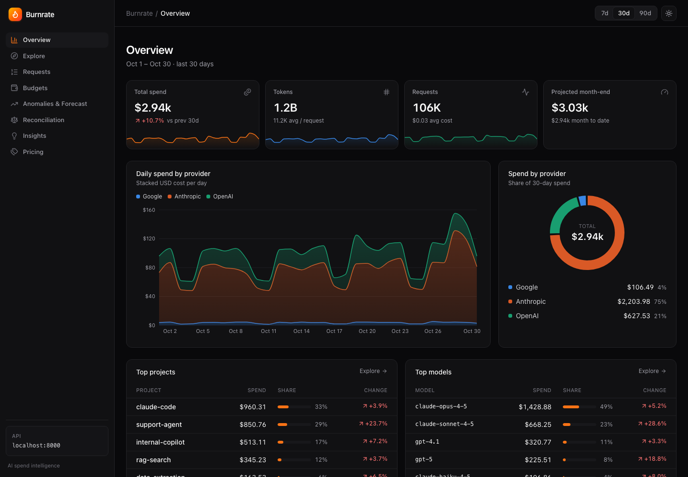
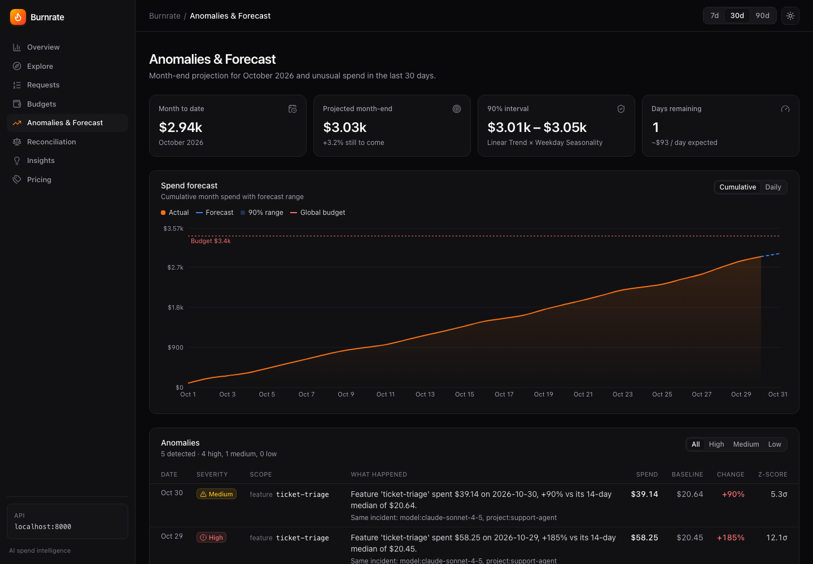
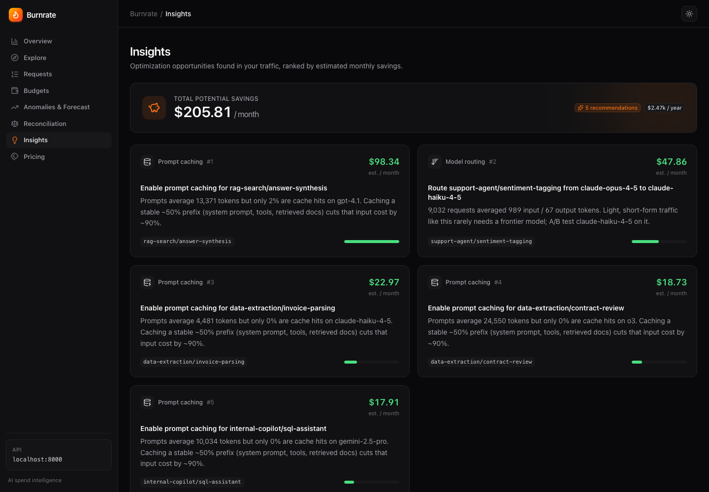
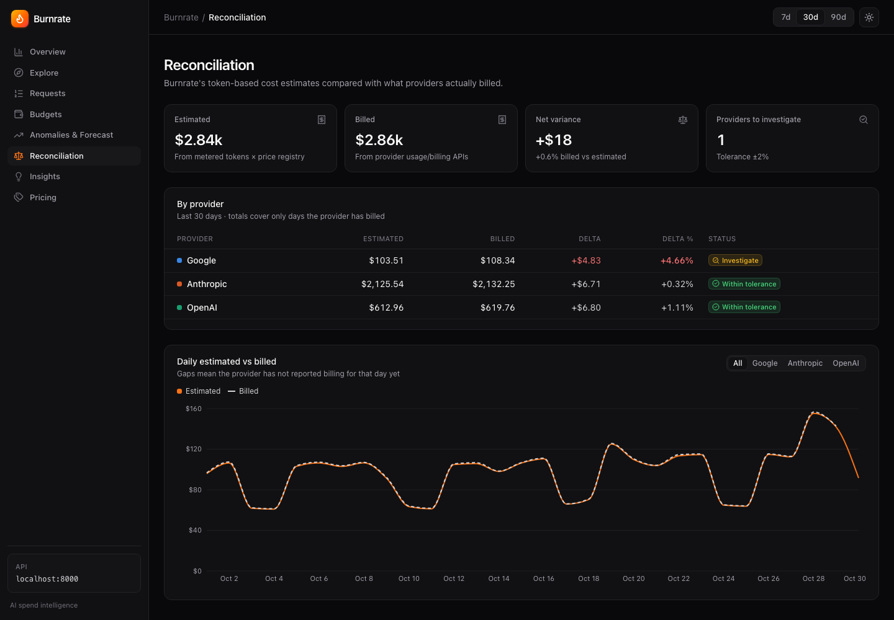
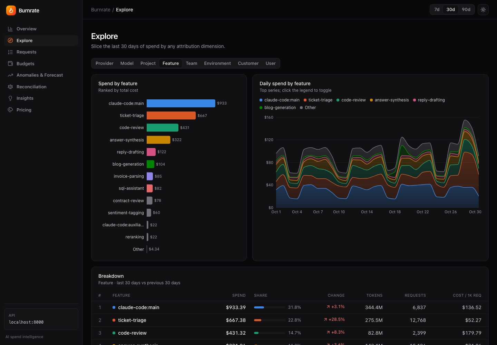

<div align="center">

# 🔥 Burnrate

**Your AI spend, checked against the real bill. No proxy.**

Burnrate tracks LLM token usage and spend across OpenAI, Anthropic, Google and others, and reconciles it against what each provider actually billed. It attributes every dollar to the project, feature, team and customer that spent it, forecasts month-end spend and catches cost spikes. Already using LiteLLM or Langfuse? Burnrate reads from them, so there's nothing to change in your apps.

[](https://github.com/Shikhaar/burnrate/actions/workflows/ci.yml)


[Quickstart](#quickstart) · [Features](#features) · [Demo script](docs/demo-script.md) · [Architecture](docs/architecture.md) · [Event schema](docs/event-schema.md) · [API](docs/api-contract.md) · [Deploy](docs/deploy.md)

</div>



---

## Why

Provider dashboards show one bill per vendor. Engineering and finance need different answers:

- *Which feature doubled our Anthropic bill this week?*
- *What does customer Acme cost us in AI each month?*
- *Will we blow the budget before month end?*
- *Does our usage data actually match the invoice?*
- *Where can we cut spend without hurting quality?*

Burnrate answers these from one place. It doesn't sit in the request path, so no proxy or gateway migration is needed. If you already run a gateway or tracing tool, Burnrate complements it rather than replacing it:

- **LiteLLM or Langfuse** already know your calls. Burnrate imports them, prices them from its own versioned registry, and checks the total against the provider's real bill, which neither tool does.
- **No proxy of its own.** Burnrate never sees prompts or sits between your app and the provider, so it can't add latency or take your app down.
- **Production and coding-agent spend together:** your apps' calls next to your engineers' Claude Code, Cursor and Copilot spend.

## Features

| | |
|---|---|
| **Unified spend** | Every provider and model in one ledger, with daily trends and period-over-period change. |
| **Attribution** | Slice by provider, model, project, feature, team, environment, customer or engineer. |
| **Traces** | Every agent run or request chain, grouped by `trace_id`: its steps in order on a timeline, what each step cost and its share of the run, repeated steps flagged as likely retries or loops, and quality scores beside the cost, so you can see cost per run by workflow next to how good the answers were. Scores come from Langfuse or `POST /v1/scores`. Prompts stay where they are: each trace links to Langfuse, Phoenix or your own tool. |
| **Request log** | Per-call tokens (input / cached / cache-write / output / reasoning), cost, latency and status. Calls to models with no known price are flagged, never silently counted as $0. |
| **Versioned pricing engine** | Price registry covering current OpenAI, Anthropic, Google and Mistral models, with cache-read/cache-write rates and dated `effective_from` versions, so announced price changes take effect on their date and past costs never move. Dated snapshots resolve to their base model (`gpt-4o-2024-08-06` → `gpt-4o`), but different models never borrow a price (`o3-mini` is not `o3`). Repricing rewrites only derived data. |
| **Works with LiteLLM and Langfuse** | Import calls from a LiteLLM proxy's spend logs or Langfuse generations with `burnrate sync litellm` / `burnrate sync langfuse`. Attribution comes from their own fields (key alias, team, end user, trace name, user id) or from `project` / `feature` / `customer_id` metadata. Prompts are never fetched. |
| **Billing reconciliation** | Pulls real charges from the OpenAI Costs API and Anthropic Cost Report. Flags providers whose bill drifts from the token-based estimate. |
| **Forecasting** | Month-end projection from a 28-day trend × weekday seasonality, with a 90% confidence band. |
| **Anomaly detection** | Robust z-score (median/MAD) per project, feature and model. When one problem shows up as several spikes (the same retry loop as a feature, model and project spike), it's reported as one incident. |
| **Budgets** | Monthly limits company-wide or per project, team, feature or customer, with projected-overrun warnings. |
| **Coding-agent spend** | Point Claude Code's built-in OpenTelemetry export at Burnrate, and import Cursor and GitHub Copilot spend from their admin APIs, to see coding-tool spend per engineer, model and tool next to production spend. |
| **Alerts** | Budget and anomaly alerts posted to Slack (or any Slack-style webhook) and, for serious ones, filed as Jira tickets (one per problem). Both are connected from Settings and checked before saving. The API checks every 15 minutes on its own; alerts are deduplicated and failed deliveries retried. |
| **Audit log** | Who signed in, and who changed people, API keys, budgets or alert settings (from the dashboard or the server CLI), with before → after values. Secrets are never recorded. |
| **Team access** | One super admin, plus any number of admins, members and viewers; only the super admin can add or change admins, and hands the role over rather than sharing it. Limit anyone to their own teams and every page, filter and API call shows only those teams' spend. Invite people and manage API keys from Settings. |
| **Savings insights** | Ranked by estimated $/month: frontier models on light traffic, uncached long prompts, money spent on failed calls. |
| **Ingestion** | Zero-dependency Python and TypeScript SDKs (background batching, retries, context-based attribution) with a LangChain callback handler and Vercel AI SDK middleware, an OTLP/HTTP receiver for OpenTelemetry GenAI spans, and a receiver for Claude Code's telemetry. Nothing sits in your request path. |
| **Engineering** | Email and password sign-in (scrypt hashes, HttpOnly session cookies, CSRF protection, throttled failed logins), Slack and Jira credentials encrypted at rest with a key kept outside the database, idempotent ingestion that stays correct under concurrent writes (`ON CONFLICT DO NOTHING`), hashed API keys, per-key and per-IP rate limiting (shared across replicas via Redis), structured JSON logs with request IDs, Prometheus metrics, Alembic migrations, health checks, and CI that runs against SQLite, Postgres and the full Docker stack. |

## Screenshots

| Anomalies & forecast | Savings insights |
|---|---|
|  |  |
| **Billing reconciliation** | **Explore by feature** |
|  |  |

## Quickstart

### Local (recommended)

Requires Python 3.11+, Node 20+ and [pnpm](https://pnpm.io).

```bash
make install    # backend venv + web deps
make seed       # 90 days of demo data into SQLite
make dev        # API on :8000 (docs at /docs), dashboard on :3000
make test       # backend + Python SDK tests
```

The dashboard is open until you create the first login. After that, everyone has to sign in:

```bash
cd backend && .venv/bin/burnrate create-user you@company.com --name "Your Name"   # prompts for a password
```

That first account is a super admin. Everything else is done from **Settings** in the dashboard (admins only):

- **Users:** add people with a role (admin, member, viewer; there is one super admin) and, optionally, the teams they may see. Burnrate gives you a one-time link to send them.
- **API keys:** create a key for each app, see when each was last used, revoke one.
- **Alerts:** connect a Slack channel and a Jira project. Burnrate tests each connection before saving it.

Stream live traffic through the real SDK while the dashboard is open:

```bash
cd backend && KEY=$(.venv/bin/burnrate create-key demo) && cd ..
BURNRATE_API_KEY=$KEY python3 examples/live_traffic.py --rps 5
```

### Docker (Postgres + API + dashboard)

```bash
docker compose up -d --build        # API runs migrations on start
docker compose run --rm seed        # demo data
open http://localhost:3000
```

> CI builds these images and runs this exact stack on every push, including seeding, live ingestion and loading every dashboard page.

## Send real usage

**Already using LiteLLM or Langfuse?** Skip the SDK and import what they've logged. No changes to your apps:

```bash
# LiteLLM proxy: a key that can read spend logs (a proxy_admin_viewer user's key is read-only)
export BURNRATE_LITELLM_URL=https://litellm.internal  BURNRATE_LITELLM_API_KEY=sk-…
burnrate sync litellm --days 30

# Langfuse (Cloud, or self-hosted v4+): the project's API keys
export BURNRATE_LANGFUSE_PUBLIC_KEY=pk-lf-…  BURNRATE_LANGFUSE_SECRET_KEY=sk-lf-…
export BURNRATE_LANGFUSE_HOST=https://us.cloud.langfuse.com   # default: Langfuse Cloud EU
burnrate sync langfuse --days 30
```

Each call becomes one Burnrate event. Calls to OpenAI, Anthropic, Google and Mistral are priced by Burnrate, so they count in reconciliation against the real bill. Other providers (Azure, Bedrock, …) keep the cost LiteLLM or Langfuse recorded. For attribution, add `project`, `feature`, `team` or `customer_id` to LiteLLM's `spend_logs_metadata` or to a Langfuse generation's metadata; otherwise Burnrate uses their own fields ([LiteLLM mapping](docs/event-schema.md#litellm), [Langfuse mapping](docs/event-schema.md#langfuse)). Re-running a sync never double-counts, but don't also send the same calls through the Burnrate SDK. Schedule it with cron ([deploy.md](docs/deploy.md#scheduled-jobs)).

**Everything else** sends events to Burnrate directly. Each app needs an ingest key. Create one in **Settings → API keys** (the full key is shown once, with a copy button), or from the CLI:

```bash
burnrate create-key "support-agent prod"     # → br_live_…  (only the hash is stored)
burnrate list-keys                           # id, name, created, last used, active/revoked
burnrate revoke-key 3                        # by id, or pass the leaked br_live_… key itself
```

Ingest keys can only *write* usage events: they can't read spend, call the dashboard API or reach your providers. Use one key per service so a leak is contained, and revoke a leaked key to reject it from the next request. Provider admin keys are a different matter; see [Keys and access](docs/deploy.md#keys-and-access).

**Python SDK** (not on PyPI yet: `pip install ./sdk/python`)

```python
from anthropic import Anthropic
from burnrate_sdk import Burnrate

br = Burnrate(api_key="br_live_…", endpoint="https://burnrate.internal", project="support-agent")
claude = Anthropic()

with br.attribute(feature="ticket-triage", customer_id="acme"):
    msg = claude.messages.create(model="claude-sonnet-4-5", max_tokens=512, messages=[...])
    br.track_anthropic(msg)          # also: track_openai(resp), track_gemini(resp, model=...)
```

The SDK only sends token counts and metadata, never prompts or completions. If Burnrate is unreachable, your app keeps running and the SDK logs a warning.

**TypeScript SDK** (not on npm yet: build it from `sdk/typescript`)

```ts
import { Burnrate } from "@burnrate/sdk";
const br = new Burnrate({ apiKey: process.env.BURNRATE_API_KEY, project: "rag-search" });
const res = await openai.chat.completions.create({ model: "gpt-4.1", messages });
br.trackOpenAI(res, { feature: "answer-synthesis", customer_id: "acme" });
```

**LangChain** (Python): one callback handler covers every chat model call in a chain or agent. Provider and model come from LangChain's run metadata; tokens from its normalized `usage_metadata`. Run metadata keys such as `customer_id` become attribution.

```python
from burnrate_sdk.langchain import BurnrateCallbackHandler

handler = BurnrateCallbackHandler(br, feature="support-agent")
agent.invoke(inputs, config={"callbacks": [handler], "metadata": {"customer_id": "acme"}})
```

**Vercel AI SDK** (v5 and v6): wrap the model once and every `generateText`, `streamText`, `generateObject` and `streamObject` call is recorded, streams included.

```ts
import { wrapLanguageModel, streamText } from "ai";
import { burnrateMiddleware } from "@burnrate/sdk";

const model = wrapLanguageModel({ model: anthropic("claude-sonnet-4-5"), middleware: burnrateMiddleware(br, { feature: "chat" }) });
streamText({ model, prompt, providerOptions: { burnrate: { customer_id: "acme" } } });  // per-call attribution
```

**OpenTelemetry:** point any OTLP/HTTP JSON exporter at `POST /v1/otlp/v1/traces` with the `X-API-Key` header. Spans carrying `gen_ai.*` attributes become usage events. Add `burnrate.feature`, `burnrate.team` and `burnrate.customer_id` for attribution.

**Claude Code (coding-agent spend per engineer)** — no code changes, just environment variables (or managed settings):

```bash
export CLAUDE_CODE_ENABLE_TELEMETRY=1
export OTEL_METRICS_EXPORTER=otlp
export OTEL_EXPORTER_OTLP_PROTOCOL=http/json
export OTEL_EXPORTER_OTLP_ENDPOINT=https://burnrate.internal/v1/otlp      # exporter appends /v1/metrics
export OTEL_EXPORTER_OTLP_HEADERS="X-API-Key=br_live_…"
export OTEL_RESOURCE_ATTRIBUTES="burnrate.team=platform"                   # optional attribution
```

The `claude_code.token.usage` and `claude_code.cost.usage` counters become usage events under project `claude-code`, attributed by `user.email`, model and session. Burnrate prices them from its registry. For models it doesn't have a price for yet, it falls back to the cost Claude Code reports.

**Cursor and GitHub Copilot** (admin APIs, no client changes):

```bash
export BURNRATE_CURSOR_ADMIN_KEY=key_…                               # Cursor team admin API key
export BURNRATE_GITHUB_TOKEN=github_pat_…  BURNRATE_GITHUB_ORG=acme   # org owner or billing manager
burnrate sync cursor --days 30
burnrate sync copilot --days 30
```

Cursor's usage events become one Burnrate event per request (project `cursor`, attributed by user email, with tokens and what Cursor charged). Copilot spend comes from GitHub's billing usage report, one event per day and SKU (seats, premium requests) under project `github-copilot`. Both are costed at what the tool charged, so they are left out of reconciliation.

**Traces and quality scores.** Calls that share a `trace_id` are one trace (an agent run, one ticket, one question). The SDKs set it from their attribution context, OpenTelemetry spans carry it, and Langfuse imports keep Langfuse's. Send quality scores, from your evals or users' thumbs up, to show next to each trace's cost:

```bash
curl -X POST localhost:8000/v1/scores -H "X-API-Key: $KEY" -H 'content-type: application/json' -d '{
  "scores": [{"trace_id": "run_42", "name": "resolved", "value": true, "id": "run_42:resolved"},
             {"trace_id": "run_42", "name": "helpfulness", "value": 0.8}]}'
```

`burnrate sync langfuse` imports Langfuse's scores too. To link traces to wherever your prompts live, set `BURNRATE_TRACE_URL_TEMPLATE` (for example `https://phoenix.internal/projects/default/traces/{trace_id}`); Langfuse traces link back to Langfuse on their own.

**Raw HTTP**

```bash
curl -X POST localhost:8000/v1/events -H "X-API-Key: $KEY" -H 'content-type: application/json' -d '{
  "events": [{"provider":"openai","model":"gpt-4o","project":"search","feature":"answer",
              "input_tokens":1200,"cached_input_tokens":800,"output_tokens":350,"request_id":"req_123"}]}'
```

**Reconcile against real bills** (provider admin keys; Burnrate only calls their read-only cost endpoints, but the keys themselves can manage your account, so see [Keys and access](docs/deploy.md#keys-and-access))

```bash
export BURNRATE_OPENAI_ADMIN_KEY=sk-admin-…  BURNRATE_ANTHROPIC_ADMIN_KEY=sk-ant-admin-…
burnrate sync all --days 31   # every configured connector, including Cursor and Copilot
```

## Demo dataset

`burnrate seed` generates a fictional SaaS company with 14 AI workloads across 6 products (including Claude Code), 6 teams and 10 customers (about 290k calls over 90 days). It contains planted problems for the dashboard to find:

- a **retry loop** in the support agent's ticket triage (last 3 days, about 3×) → high-severity anomaly, exceeded budget, and on the Traces page support runs with `ticket-triage ×4` and lower `resolved` scores
- the support agent's and RAG search's calls grouped into **traces with quality scores** → cost per run by workflow
- a **bulk content job** run on a frontier model → past anomaly
- **Opus used for sentiment tagging** (900-token prompts) → model-downgrade insight
- **Claude Code** usage across 8 engineers, with one power user → per-engineer breakdown
- **12k-token RAG prompts with no caching** → prompt-caching insight
- a **Google bill running 4.7% above estimate** → reconciliation flag

## Tech

**Backend:** Python 3.11+ (Docker image on 3.14), FastAPI, SQLAlchemy 2.0, Pydantic v2, PostgreSQL / SQLite, httpx · **Dashboard:** Next.js 16, React 19, TypeScript, Tailwind CSS v4, Recharts · **Infra:** Docker Compose, GitHub Actions (backend on SQLite + Postgres, SDKs on Python 3.10 & 3.13 and Node 22, web lint + build, full Docker stack boot)

```
backend/         FastAPI service, pricing engine, analytics, connectors, CLI, tests
web/             Next.js dashboard
sdk/python/      zero-dependency Python SDK
sdk/typescript/  zero-dependency TypeScript SDK
examples/        live traffic simulator
docs/            architecture, event schema, API contract, deployment, demo script
```

## Status

Burnrate is a complete, tested reference implementation, not yet a hosted service:

- **Verified:** 130 backend tests and SDK tests in both languages. The LangChain handler was also checked against `langchain-core` 1.7, and the AI SDK middleware against `ai` 5 and 6. CI runs ingestion against real Postgres and boots the whole Docker stack end to end.
- **Not yet built:** multi-tenant organizations, SSO, sending email (invite and reset links are copied and sent by the admin), storing prompts and responses (by design: traces link to Langfuse, Phoenix or your own tool for those), and a built-in scheduler for billing sync (use cron; see [deploy.md](docs/deploy.md)).
- **Check before relying on numbers:** model prices in [`pricing.yaml`](backend/src/burnrate/data/pricing.yaml) were last checked against OpenAI, Anthropic, Google and Mistral's published prices on 2026-11-13; long-prompt surcharges and longer cache tiers are not modelled (see the file's header). The OpenAI billing, Cursor, GitHub Copilot, LiteLLM and Langfuse connectors, and the Slack and Jira alert integrations, are tested against stand-ins built from each API's docs, not yet against the live services.

## Roadmap

- LlamaIndex callbacks
- More coding agents (Codex, Windsurf), and Copilot premium requests broken down by model
- Email alerts and invites, and per-team alert channels
- Multi-tenant orgs and SSO
- Hosted demo
- OpenTelemetry tracing for Burnrate itself
- ClickHouse rollups for very high event volumes
- Tiered prices: long-prompt surcharges and longer cache-write tiers (currently priced at the base tier)

## License

MIT
