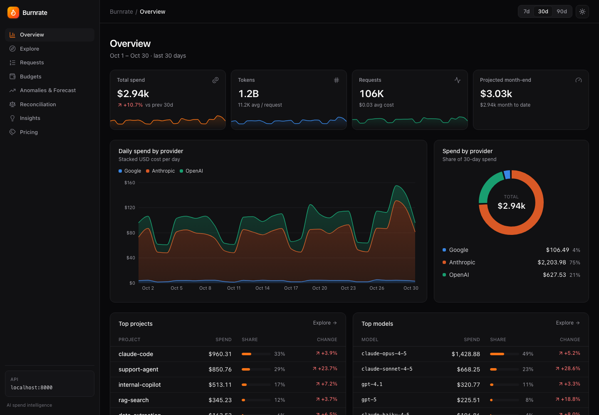
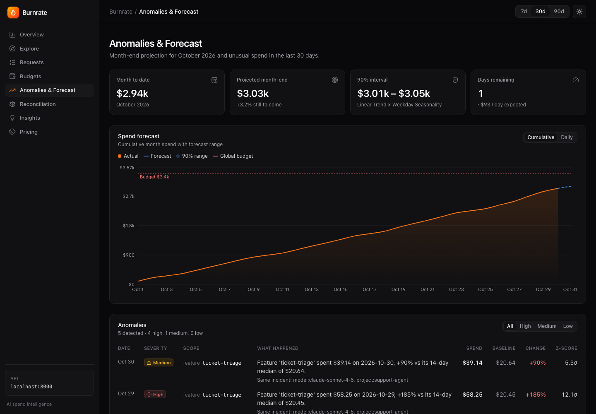
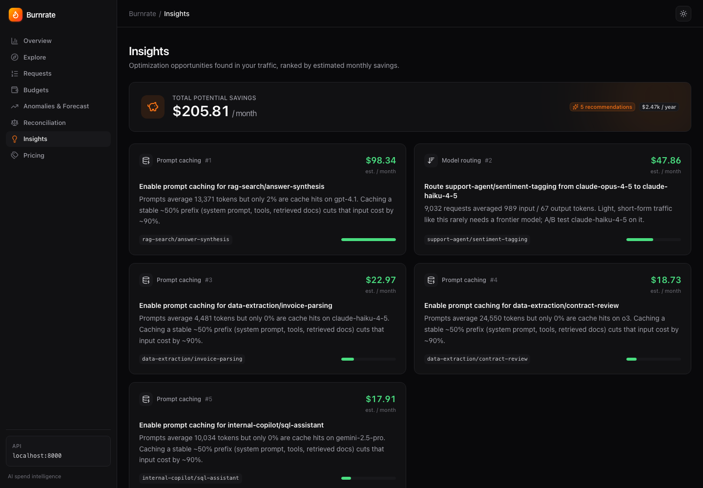
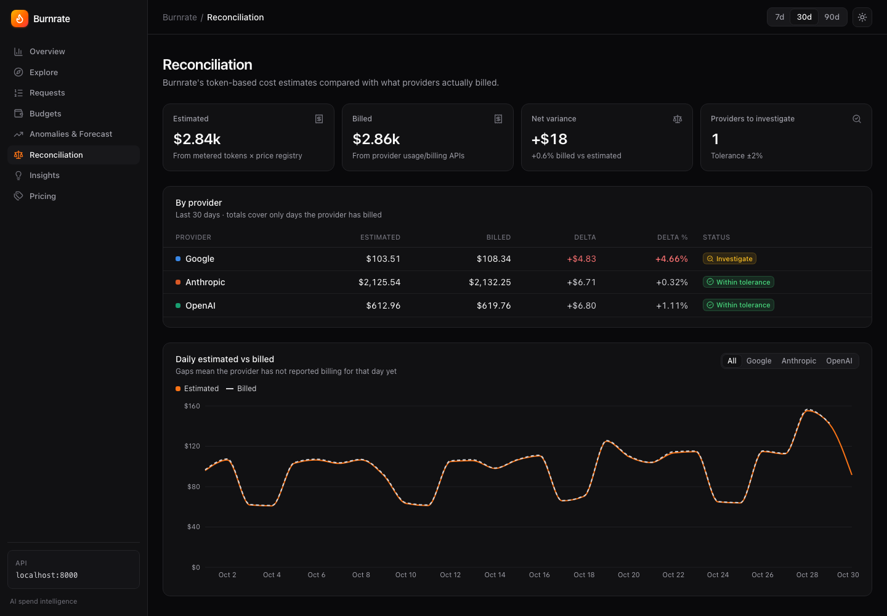
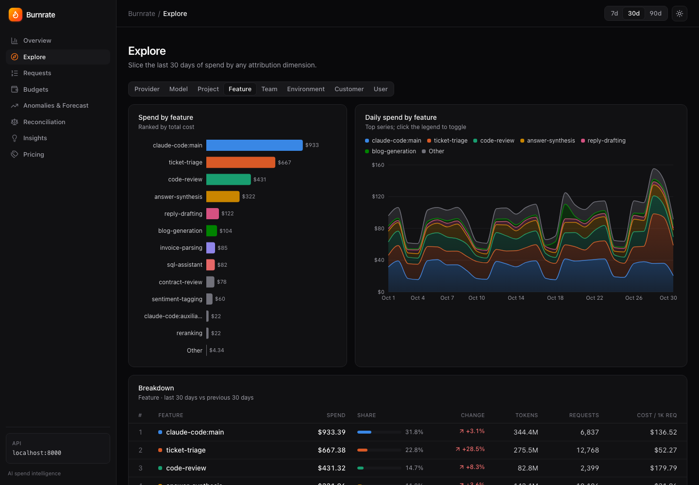

<div align="center">

# 🔥 Burnrate

**See where your AI money goes.**

Burnrate tracks LLM token usage and spend across OpenAI, Anthropic, Google and others. It attributes every dollar to the project, feature, team and customer that spent it, forecasts month-end spend, catches cost spikes, and reconciles its estimates against what providers actually bill.

[](https://github.com/Shikhaar/burnrate/actions/workflows/ci.yml)


[Quickstart](#quickstart) · [Features](#features) · [Demo script](docs/demo-script.md) · [Architecture](docs/architecture.md) · [Event schema](docs/event-schema.md) · [API](docs/api-contract.md) · [Deploy](docs/deploy.md)

</div>



---

## Why

Provider dashboards show one bill per vendor. Engineering and finance need different answers:

- *Which feature doubled our Anthropic bill this week?*
- *What does customer Acme cost us in AI each month?*
- *Will we blow the budget before month end?*
- *Does our usage data actually match the invoice?*
- *Where can we cut spend without hurting quality?*

Burnrate answers these from one place. It doesn't sit in the request path, so no proxy or gateway migration is needed.

## Features

| | |
|---|---|
| **Unified spend** | Every provider and model in one ledger, with daily trends and period-over-period change. |
| **Attribution** | Slice by provider, model, project, feature, team, environment, customer or engineer. |
| **Request log** | Per-call tokens (input / cached / cache-write / output / reasoning), cost, latency and status. Calls to models with no known price are flagged, never silently counted as $0. |
| **Versioned pricing engine** | Price registry with `effective_from` versions and cache-read/cache-write rates. Dated snapshots resolve to their base model (`gpt-4o-2024-08-06` → `gpt-4o`), but different models never borrow a price (`o3-mini` is not `o3`). Repricing rewrites only derived data. |
| **Billing reconciliation** | Pulls real charges from the OpenAI Costs API and Anthropic Cost Report. Flags providers whose bill drifts from the token-based estimate. |
| **Forecasting** | Month-end projection from a 28-day trend × weekday seasonality, with a 90% confidence band. |
| **Anomaly detection** | Robust z-score (median/MAD) per project, feature and model. When one problem shows up as several spikes (the same retry loop as a feature, model and project spike), it's reported as one incident. |
| **Budgets** | Monthly limits company-wide or per project, team, feature or customer, with projected-overrun warnings. |
| **Coding-agent spend** | Point Claude Code's built-in OpenTelemetry export at Burnrate to see coding-agent spend per engineer, model and session next to production spend. |
| **Alerts** | Budget and anomaly alerts sent to Slack or any webhook. Deduplicated, so each condition notifies once (`burnrate alerts` from cron). |
| **Savings insights** | Ranked by estimated $/month: frontier models on light traffic, uncached long prompts, money spent on failed calls. |
| **Ingestion** | Zero-dependency Python and TypeScript SDKs (background batching, retries, context-based attribution), an OTLP/HTTP receiver for OpenTelemetry GenAI spans, and a receiver for Claude Code's telemetry. Nothing sits in your request path. |
| **Engineering** | Idempotent ingestion that stays correct under concurrent writes (`ON CONFLICT DO NOTHING`), hashed API keys, per-key and per-IP rate limiting, structured JSON logs with request IDs, Alembic migrations, health checks, and CI that runs against SQLite, Postgres and the full Docker stack. |

## Screenshots

| Anomalies & forecast | Savings insights |
|---|---|
|  |  |
| **Billing reconciliation** | **Explore by feature** |
|  |  |

## Quickstart

### Local (recommended)

Requires Python 3.11+, Node 20+ and [pnpm](https://pnpm.io).

```bash
make install    # backend venv + web deps
make seed       # 90 days of demo data into SQLite
make dev        # API on :8000 (docs at /docs), dashboard on :3000
make test       # backend + Python SDK tests
```

Stream live traffic through the real SDK while the dashboard is open:

```bash
cd backend && KEY=$(.venv/bin/burnrate create-key demo) && cd ..
BURNRATE_API_KEY=$KEY python3 examples/live_traffic.py --rps 5
```

### Docker (Postgres + API + dashboard)

```bash
docker compose up -d --build        # API runs migrations on start
docker compose run --rm seed        # demo data
open http://localhost:3000
```

> CI builds these images and runs this exact stack on every push, including seeding, live ingestion and loading every dashboard page.

## Send real usage

```bash
burnrate create-key "support-agent prod"     # → br_live_…  (only the hash is stored)
```

**Python SDK** (not on PyPI yet: `pip install ./sdk/python`)

```python
from anthropic import Anthropic
from burnrate_sdk import Burnrate

br = Burnrate(api_key="br_live_…", endpoint="https://burnrate.internal", project="support-agent")
claude = Anthropic()

with br.attribute(feature="ticket-triage", customer_id="acme"):
    msg = claude.messages.create(model="claude-sonnet-4-5", max_tokens=512, messages=[...])
    br.track_anthropic(msg)          # also: track_openai(resp), track_gemini(resp, model=...)
```

The SDK only sends token counts and metadata, never prompts or completions. If Burnrate is unreachable, your app keeps running and the SDK logs a warning.

**TypeScript SDK** (not on npm yet: build it from `sdk/typescript`)

```ts
import { Burnrate } from "@burnrate/sdk";
const br = new Burnrate({ apiKey: process.env.BURNRATE_API_KEY, project: "rag-search" });
const res = await openai.chat.completions.create({ model: "gpt-4.1", messages });
br.trackOpenAI(res, { feature: "answer-synthesis", customer_id: "acme" });
```

**OpenTelemetry:** point any OTLP/HTTP JSON exporter at `POST /v1/otlp/v1/traces` with the `X-API-Key` header. Spans carrying `gen_ai.*` attributes become usage events. Add `burnrate.feature`, `burnrate.team` and `burnrate.customer_id` for attribution.

**Claude Code (coding-agent spend per engineer)** — no code changes, just environment variables (or managed settings):

```bash
export CLAUDE_CODE_ENABLE_TELEMETRY=1
export OTEL_METRICS_EXPORTER=otlp
export OTEL_EXPORTER_OTLP_PROTOCOL=http/json
export OTEL_EXPORTER_OTLP_ENDPOINT=https://burnrate.internal/v1/otlp      # exporter appends /v1/metrics
export OTEL_EXPORTER_OTLP_HEADERS="X-API-Key=br_live_…"
export OTEL_RESOURCE_ATTRIBUTES="burnrate.team=platform"                   # optional attribution
```

The `claude_code.token.usage` and `claude_code.cost.usage` counters become usage events under project `claude-code`, attributed by `user.email`, model and session. Burnrate prices them from its registry. For models it doesn't have a price for yet, it falls back to the cost Claude Code reports.

**Raw HTTP**

```bash
curl -X POST localhost:8000/v1/events -H "X-API-Key: $KEY" -H 'content-type: application/json' -d '{
  "events": [{"provider":"openai","model":"gpt-4o","project":"search","feature":"answer",
              "input_tokens":1200,"cached_input_tokens":800,"output_tokens":350,"request_id":"req_123"}]}'
```

**Reconcile against real bills** (read-only admin keys)

```bash
export BURNRATE_OPENAI_ADMIN_KEY=sk-admin-…  BURNRATE_ANTHROPIC_ADMIN_KEY=sk-ant-admin-…
burnrate sync all --days 31
```

## Demo dataset

`burnrate seed` generates a fictional SaaS company with 14 AI workloads across 6 products (including Claude Code), 6 teams and 10 customers (about 290k calls over 90 days). It contains planted problems for the dashboard to find:

- a **retry loop** in the support agent's ticket triage (last 3 days, about 3×) → high-severity anomaly, exceeded budget
- a **bulk content job** run on a frontier model → past anomaly
- **Opus used for sentiment tagging** (900-token prompts) → model-downgrade insight
- **Claude Code** usage across 8 engineers, with one power user → per-engineer breakdown
- **12k-token RAG prompts with no caching** → prompt-caching insight
- a **Google bill running 4.7% above estimate** → reconciliation flag

## Tech

**Backend:** Python 3.12, FastAPI, SQLAlchemy 2.0, Pydantic v2, PostgreSQL / SQLite, httpx · **Dashboard:** Next.js 15, TypeScript, Tailwind CSS v4, Recharts · **Infra:** Docker Compose, GitHub Actions (backend on SQLite + Postgres, SDKs on Python 3.10 & 3.13 and Node 22, web lint + build, full Docker stack boot)

```
backend/         FastAPI service, pricing engine, analytics, connectors, CLI, tests
web/             Next.js dashboard
sdk/python/      zero-dependency Python SDK
sdk/typescript/  zero-dependency TypeScript SDK
examples/        live traffic simulator
docs/            architecture, event schema, API contract, deployment, demo script
```

## Status

Burnrate is a complete, tested reference implementation, not yet a hosted service:

- **Verified:** 42 backend tests and SDK tests in both languages. CI runs ingestion against real Postgres and boots the whole Docker stack end to end.
- **Not yet built:** user accounts and multi-tenant organizations (the dashboard API is protected by a single optional token), metrics and tracing, a shared rate-limit store for multiple API replicas (limits are per process today), and a built-in scheduler for alerts and billing sync (use cron; see [deploy.md](docs/deploy.md)).
- **Check before relying on numbers:** model prices in [`pricing.yaml`](backend/src/burnrate/data/pricing.yaml) should be verified against each provider's pricing page. The OpenAI billing connector is tested against sample responses, not yet against the live API.

## Roadmap

- LangChain / LlamaIndex / Vercel AI SDK callbacks
- More coding agents (Cursor, Copilot, Codex) via their admin APIs
- Email alerts and per-team routing
- User accounts, multi-tenant orgs, SSO and role-based access control
- Hosted demo
- Prometheus metrics and a Redis-backed rate-limit store for multiple replicas
- ClickHouse rollups for very high event volumes

## License

MIT
